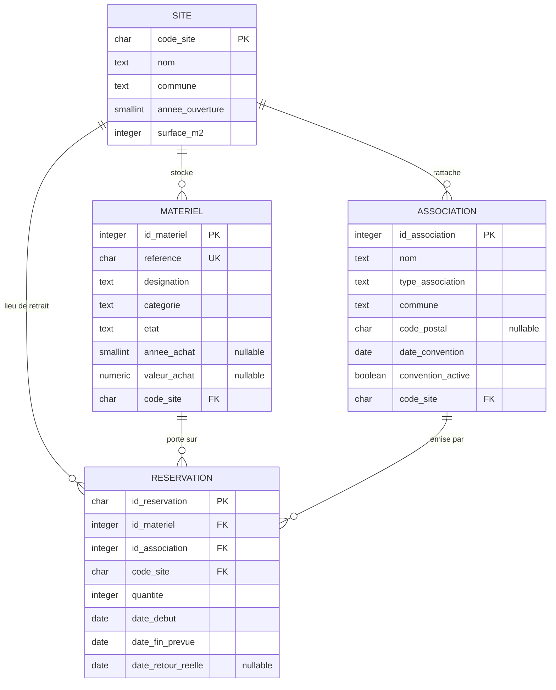

# Etape 4 - Modelisation du prêt de materiel (CCFL)

## 1. MCD - Modele conceptuel de donnees

### Les quatre entites

**SITE** - un pole de retrait du materiel.

| Propriete | Description |
|---|---|
| `code_site` | identifiant du pole, de la forme `POL-HAZ` |
| `nom` | nom du pole |
| `commune` | commune d'implantation |
| `annee_ouverture` | annee d'ouverture |
| `surface_m2` | surface de stockage en m2 |

**MATERIEL** - un bien prêtable, stocke dans un pole.

| Propriete | Description |
|---|---|
| `id_materiel` | identifiant du materiel |
| `reference` | reference d'inventaire, de la forme `MAT-0001` |
| `designation` | libelle du materiel |
| `categorie` | une des six categories du service |
| `etat` | neuf, bon, moyen ou a reviser |
| `annee_achat` | annee d'acquisition, parfois inconnue |
| `valeur_achat` | valeur d'achat en euros, parfois inconnue |

**ASSOCIATION** - une association du territoire ayant signe une convention.

| Propriete | Description |
|---|---|
| `id_association` | identifiant de l'association |
| `nom` | nom de l'association |
| `type_association` | sportive, culturelle, sociale, festive, scolaire ou inconnu |
| `commune` | commune du siege |
| `code_postal` | code postal du siege, parfois absent |
| `date_convention` | date de signature de la convention |
| `convention_active` | la convention est-elle active |

**RESERVATION** - un prêt de materiel a une association.

| Propriete | Description |
|---|---|
| `id_reservation` | identifiant du prêt, de la forme `R250000` |
| `quantite` | nombre d'unites empruntees |
| `date_debut` | date de depart du prêt |
| `date_fin_prevue` | date de retour prevue |
| `date_retour_reelle` | date de retour effective, vide tant que le materiel n'est pas rendu |

### Les associations et leurs cardinalites

| Association | Entites | Cardinalites | Lecture |
|---|---|---|---|
| **stocke** | SITE - MATERIEL | (0,n) - (1,1) | Un pole stocke zero a plusieurs materiels. Un materiel est stocke dans un et un seul pole. |
| **rattache** | SITE - ASSOCIATION | (0,n) - (1,1) | Un pole rattache zero a plusieurs associations. Une association est rattachee a un et un seul pole. |
| **porte sur** | MATERIEL - RESERVATION | (0,n) - (1,1) | Un materiel fait l'objet de zero a plusieurs reservations. Une reservation porte sur un et un seul materiel. |
| **emise par** | ASSOCIATION - RESERVATION | (0,n) - (1,1) | Une association emet zero a plusieurs reservations. Une reservation est emise par une et une seule association. |
| **retiree a** | SITE - RESERVATION | (0,n) - (1,1) | Un pole est le lieu de retrait de zero a plusieurs reservations. Une reservation a un et un seul lieu de retrait. |

RESERVATION n'est pas une association porteuse de donnees entre MATERIEL et
ASSOCIATION mais bien une entite a part entiere : elle possede son propre
identifiant metier (`R250000`), et deux prêts du même materiel par la même
association a deux dates differentes sont deux reservations distinctes.

### Schema

---

## 2. MLD - Modele logique de donnees

Cle primaire soulignee par `PK`, cle etrangere par `FK`.

### site

| Attribut | Type | Contrainte |
|---|---|---|
| code_site | CHAR(7) | PK |
| nom | TEXT | NOT NULL |
| commune | TEXT | NOT NULL |
| annee_ouverture | SMALLINT | NOT NULL |
| surface_m2 | INTEGER | NOT NULL |

### materiel

| Attribut | Type | Contrainte |
|---|---|---|
| id_materiel | INTEGER | PK |
| reference | CHAR(8) | NOT NULL, UNIQUE |
| designation | TEXT | NOT NULL |
| categorie | TEXT | NOT NULL |
| etat | TEXT | NOT NULL |
| annee_achat | SMALLINT | NULL autorise |
| code_site | CHAR(7) | NOT NULL, FK vers site(code_site) |
| valeur_achat | NUMERIC(8,2) | NULL autorise |

### association

| Attribut | Type | Contrainte |
|---|---|---|
| id_association | INTEGER | PK |
| nom | TEXT | NOT NULL |
| type_association | TEXT | NOT NULL |
| commune | TEXT | NOT NULL |
| code_postal | CHAR(5) | NULL autorise |
| date_convention | DATE | NOT NULL |
| code_site | CHAR(7) | NOT NULL, FK vers site(code_site) |
| convention_active | BOOLEAN | NOT NULL |

### reservation

| Attribut | Type | Contrainte |
|---|---|---|
| id_reservation | CHAR(7) | PK |
| id_materiel | INTEGER | NOT NULL, FK vers materiel(id_materiel) |
| id_association | INTEGER | NOT NULL, FK vers association(id_association) |
| code_site | CHAR(7) | NOT NULL, FK vers site(code_site) |
| quantite | INTEGER | NOT NULL, CHECK (quantite > 0) |
| date_debut | DATE | NOT NULL |
| date_fin_prevue | DATE | NOT NULL, CHECK (date_fin_prevue >= date_debut) |
| date_retour_reelle | DATE | NULL autorise |

Soit cinq cles etrangeres au total : deux depuis `materiel` et `association`
vers `site`, trois depuis `reservation` vers `materiel`, `association` et
`site`.

---

## 3. Justifications

**Cle primaire de `reservation`.** `R250000` est une lettre suivie de six
chiffres : pas un nombre, et toujours sept caracteres. D'ou `CHAR(7)`, qui fixe
la longueur plutot que de la laisser varier.

**Type de `valeur_achat`.** Un flottant stocke les decimaux en binaire et les
arrondit : l'erreur est invisible sur une ligne mais s'accumule sur une somme,
or la direction demande la valeur du parc par pole. `NUMERIC(8,2)` est exact,
jusqu'a 999 999,99 euros.

**`convention_active`.** La source contient `oui` ou `non` : deux valeurs
exclusives, donc un `BOOLEAN`, converti au chargement. En texte, il faudrait
comparer des chaines et accepter `OUI`, `Oui` ou `o`.

**`date_retour_reelle`.** Nullable, et ce `NULL` signifie « pret en cours », pas
« donnee manquante ». Une date conventionnelle fausserait le taux de retard et
la duree moyenne calcules a l'etape 6.

**`code_site` sur trois tables.** Information distincte, pas redondance : le
pole de stockage du materiel, le pole de rattachement de l'association et le
pole de retrait du pret peuvent differer. Le deduire de l'association
reecrirait l'historique des que celle-ci change de rattachement.

**Colonnes nullables.** Seulement quatre : `annee_achat`, `valeur_achat`,
`code_postal` et `date_retour_reelle`. Les trois premieres sont les valeurs
manquantes conservees a l'etape 3. Tout le reste est `NOT NULL`.
